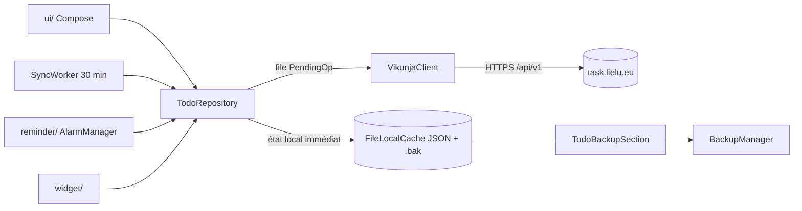

# Architecture : vue d'ensemble

Pour qui : développeur qui découvre le code. Pourquoi : savoir où est chaque responsabilité avant de modifier.

Package Kotlin `com.lielu.todo` (`app/src/main/java/com/lielu/todo`). MVVM + Compose, injection manuelle par
`AppContainer`. La version web (`web/`) reproduit la même logique en JavaScript.

| Dossier | Rôle |
| --- | --- |
| `data/api` | `HttpApi` (abstrait pour les tests), `VikunjaClient` (HttpURLConnection + org.json, connexion 6 s), `SessionStore` (jeton, hors sauvegarde Android). |
| `data/todo` | `TodoRepository` (source de vérité), `TodoState`/`TodoStateCodec`, `QuickAddParser`, `Productivity`, `TaskSearch`, `LocalCache`. |
| `data/settings` | DataStore (thème, sauvegarde auto) ; `AppPrefs` (verrou, son, icône : SharedPreferences, par appareil). |
| `backup` | Format `lielu-backup`, `BackupManager`, `AutoBackupRunner`, dossier SAF. |
| `reminder` | Alarmes, notifications Terminer/Reporter, résumé quotidien. |
| `widget` | Widget liste configurable + ajout rapide. |
| `work` | `SyncWorker` (30 min), `AutoBackupWorker` (quotidien). |
| `ui` | Écrans : `home/`, `task/`, `login/`, `settings/`, `update/`, `theme/` (aucune couleur en dur ailleurs). |

## Points d'attention
- Une `Task` garde son JSON serveur (`raw`) : Vikunja remplace la tâche entière à chaque mise à jour.
- `TodoState` est sérialisé par `TodoStateCodec` (cache ET sauvegarde) : tout nouveau champ a une valeur par défaut
  à la lecture, sinon les anciens fichiers deviennent illisibles.
- Verrou : confirmation de l'appareil (`KeyguardManager`), aucune donnée biométrique dans l'app.
- Mise à jour automatique (`lielugit-updater`) : uniquement `production` en `release`.
- Icône d'app : `activity-alias` du manifest, un seul actif à la fois.
